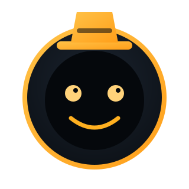
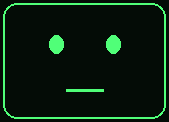
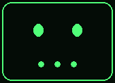
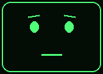
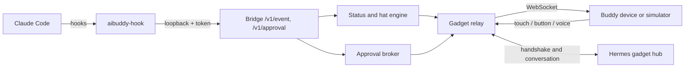

<p align="center">
  
</p>

<h1 align="center">AI Buddy</h1>

<p align="center">
  <b>A desk companion with hats.</b><br>
  A small expressive buddy that shows what your coding agent is doing, asks before it acts, and speaks in the voice of the persona you choose.
</p>

<p align="center">
  
  
  
  
</p>

---

## Why

Coding agents ask for permission in a terminal you may not be watching. AI Buddy puts that conversation on a small screen on your desk:

- **Glance** at the face to see whether your agent is working, waiting for you, finished or stuck.
- **Approve or deny** a command with a tap, a button, or a spoken "no", without switching windows.
- **Choose a personality.** The same "done" event reads differently from **Geek**, **Coach** or **Sentinel**.

Everything runs on your own machine and network. There is no cloud service of ours in the loop.

## Hats

A hat is a persona made of plain files: a name, a personality prompt, face images, and reaction rules. Drop a folder into `hats/` and it appears, with no code changes.

| Geek | Coach | Sentinel | Buddy (default) |
|:---:|:---:|:---:|:---:|
|  |  |  |  |
| *Dry and terse. "Build's green. Ship it."* | *Upbeat. "Nice work. Stretch break?"* | *Serious. Speaks only when something needs you.* | *Plain and neutral.* |

Every hat ships six faces: `idle`, `working`, `waiting`, `done`, `error` and `disconnected`. Here is Geek in each state:

<p align="center">
  
  
  
  
  
  
</p>

Write your own hat:

```text
hats/pirate/
├── hat.yaml        # name, priority, reactions
├── persona.md      # the personality
└── faces/          # PNG per state (missing ones fall back to the default hat)
```

```yaml
format: 1
name: Pirate
priority: 40
persona: persona.md
reactions:
  - when: done
    say: "Treasure found: {summary}"
    face: done
```

Check a hat with `aibuddy hats --check`. A broken hat is skipped and reported, and the buddy keeps working.

## How it works



- The **relay** sits between the device and Hermes. It passes Hermes traffic through unchanged and adds the buddy's own frames: status, cards, images and approval prompts.
- The **approval broker** shows one prompt at a time and resolves it exactly once.
- Hermes stays the default **brain**, and the device stays a thin client, following [physical-hermes](https://github.com/RegeneratusLabs/physical-hermes).

## The one rule

> **The buddy never approves an action on its own.**

Only an explicit touch or button press approves. Timeouts, a dropped connection, a garbled answer and a spoken "yes" all fall back to your normal computer prompt. A spoken "no" denies. High-risk commands such as `rm -rf`, `sudo` and force pushes get no approve button at all, so you review them on the computer.

## Quick start

Requires Python 3.10+.

```bash
git clone https://github.com/devrdias/ai-buddy.git
cd ai-buddy
python3 -m venv .venv && source .venv/bin/activate
pip install -e ".[dev]"

pytest                        # 156 tests, no hardware needed
aibuddy hats --check          # list hats and report problems
aibuddy hat use geek          # choose the active hat
aibuddy run                   # start the device relay and the hook bridge
```

Point Claude Code at the bridge by adding these hooks to `.claude/settings.json`. Set the `PermissionRequest` timeout above the buddy's 60-second approval window:

```json
{
  "hooks": {
    "SessionStart":     [{ "hooks": [{ "type": "command", "command": "aibuddy-hook" }] }],
    "UserPromptSubmit": [{ "hooks": [{ "type": "command", "command": "aibuddy-hook" }] }],
    "PreToolUse":       [{ "hooks": [{ "type": "command", "command": "aibuddy-hook" }] }],
    "PostToolUse":      [{ "hooks": [{ "type": "command", "command": "aibuddy-hook" }] }],
    "Stop":             [{ "hooks": [{ "type": "command", "command": "aibuddy-hook" }] }],
    "Notification":     [{ "hooks": [{ "type": "command", "command": "aibuddy-hook" }] }],
    "PermissionRequest": [{ "matcher": "*", "hooks": [{ "type": "command", "command": "aibuddy-hook", "timeout": 70 }] }]
  }
}
```

No device yet? Use the [Hermes Gadget SDK](https://github.com/Adolanium/hermes-gadget-sdk) desktop simulator (`hermes-gadget sim`) and point it at `ws://127.0.0.1:8770/gadget`.

## Configuration

Settings come from `config.yaml` (optional) and environment variables, which win:

| Variable | Default | Meaning |
|---|---|---|
| `AIBUDDY_UPSTREAM_URL` | `ws://127.0.0.1:8765/gadget` | Hermes gadget hub |
| `AIBUDDY_UPSTREAM_TOKEN` | unset | Hermes access token, if one is set |
| `AIBUDDY_LISTEN_HOST` / `AIBUDDY_LISTEN_PORT` | `127.0.0.1` / `8770` | Device endpoint |
| `AIBUDDY_BRIDGE_PORT` | `8771` | Hook bridge (loopback only) |
| `AIBUDDY_HATS_DIR` | `hats` | Where hat folders live |
| `AIBUDDY_ALLOW_LAN` | `false` | Must be `true` to listen beyond loopback |

The bridge token lives in `~/.config/aibuddy/token` with mode `0600`. The hook refuses a token file that others can read.

## Status

AI Buddy is **early alpha**. What works today is tested on the host side, with no hardware:

- [x] Status on the face, with stale activity shown as *Disconnected*
- [x] Approvals by touch, button or voice-deny, with the fail-safe rules
- [x] Hats: loading, validation, reactions, face conversion and manual switching
- [x] Hook bridge and device relay, with the handshake kept in order
- [ ] Live test on a real board (the SpotPear 1.28" round robot is the target)
- [ ] Live Claude Code permission run (the hook timeout is documented but not yet measured)
- [ ] Voice conversation through Hermes (US4)
- [ ] Quiet hours and do-not-disturb (US5)
- [ ] Device setup guide and porting guide (US6)

The design lives in [`specs/001-hat-desk-buddy/`](specs/001-hat-desk-buddy/): the spec, plan, research and spike results, contracts, and tasks.

## Built with

Developed with [spec-kit](https://github.com/github/spec-kit) and [Claude Code](https://claude.com/claude-code).

## Credits

AI Buddy stands on other people's work:

- **[physical-hermes](https://github.com/RegeneratusLabs/physical-hermes)** by RegeneratusLabs: the idea of giving a cheap voice robot a body for an agent.
- **[Hermes Gadget SDK](https://github.com/Adolanium/hermes-gadget-sdk)** by Adolanium and contributors (MIT): the device firmware, protocol and simulator that this project relays to. AI Buddy uses it as a tool and copies no code.
- **[xiaozhi-esp32](https://github.com/78/xiaozhi-esp32)**: the open-source firmware the robot ships with, and the source of its board definitions.
- **[Hermes Agent](https://hermes-agent.nousresearch.com)** by [Nous Research](https://nousresearch.com): the default brain. AI Buddy is an independent community project and is not affiliated with Nous Research.

## License

Not yet chosen. Please do not reuse this code until a `LICENSE` file is added.
